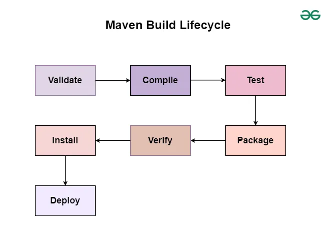

## Maven Handson

- Maven is a build automation tool which uses a Project Object Model (POM) file to manage project dependencies, build configurations, and plugins.




1. Create a simple maven project using the below command

    ```bash
    mvn archetype:generate -DgroupId=com.dharmaraj -DartifactId=simple_maven_project -DarchetypeArtifactId=maven-archetype-quickstart -DinteractiveMode=false
    ```

2. To use **@Test** annotation, add the `junit-jupiter-api` dependency in the [pom.xml](pom.xml) file.

    ```xml
    <dependency>
        <groupId>org.junit.jupiter</groupId>
        <artifactId>junit-jupiter-api</artifactId>
        <version>5.13.4</version>
        <scope>test</scope>
    </dependency>
    ```

3. `mvn compile` will download the dependencies and create class files in the _target_ directory.

4. `mvn clean` will remove the _target_ directory. 

5. To run the test cases, use the below command.

    ```bash
    mvn clean test
    ```

6. `mvn package` will create a jar file in the _target_ directory.

7. To run the jar file, use the below command.

    ```bash
    java -jar target/simple_maven_project-1.0-SNAPSHOT.jar
    ```

8. If you get `no main manifest attribute`, the JAR was built without a `Main-Class` entry. Add the `maven-jar-plugin` main class config in [pom.xml](pom.xml), run `mvn package` and then run the jar file again.

    ```log
    Hello world!
    ```

    The Main function will be executed and the output will be printed in the console.

9. `mvn install` will install the jar file in the local maven repository. The default location is `~/.m2/repository/`. When you run `mvn install`, Maven will copy the jar file to the local repository so that it can be used as a dependency in other projects.

10. To use the jar file in another project, add the dependency in the [pom.xml](pom.xml) file of the new project.

    ```xml
    <dependency>
        <groupId>com.dharmaraj</groupId>
        <artifactId>simple_maven_project</artifactId>
        <version>1.0-SNAPSHOT</version>
    </dependency>
    ```
